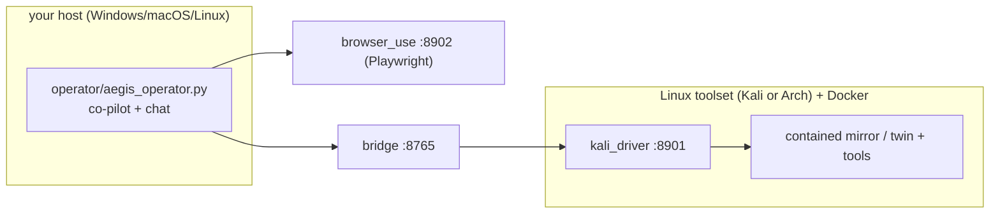

# Installing Aegis-Artex (bare-bones, from scratch)

Aegis-Artex is self-hosted. You need: **Python 3.12+**, a **Linux toolset host** (Kali or Arch Linux — in
WSL, a VM, or bare metal) with **Docker** for the contained mirror + scanner tools, and at least one
**LLM provider** key. Nothing is bundled — this installs cleanly on a barebones system.



---

## 1. Get the code + Python env
```bash
git clone https://github.com/dsagent1/Aegis-Artex.git
cd Aegis-Artex
python -m venv .venv
. .venv/bin/activate            # Windows PowerShell:  .venv\Scripts\Activate.ps1
pip install -r requirements.txt
python -m playwright install chromium     # only needed for the browser_use executor
```

## 2. The Linux toolset host (Kali or Arch)
The Kali/Arch host runs the scanner tools and the **contained mirror** (a Docker twin of your target).
Pick one:

### Option A — Kali Linux (WSL or VM)
```bash
# inside Kali
sudo apt update && sudo apt install -y docker.io nmap
sudo usermod -aG docker "$USER"      # log out/in (WSL: `wsl --terminate kali-linux`) so it takes effect
# project scanners (install what your assessments use):
sudo apt install -y nikto whatweb ffuf   # etc. — nuclei/httpx/katana via their own installers
```

### Option B — Arch Linux (VM or bare metal)
```bash
# inside Arch
sudo pacman -Syu --needed docker nmap python git
sudo systemctl enable --now docker
sudo usermod -aG docker "$USER"      # re-login so the group applies
# scanners from the repos / AUR as needed:
sudo pacman -S --needed nikto whatweb   # nuclei/httpx/ffuf via pacman/AUR/go install
```

Set the distro name the drivers shell into (default `kali-linux`):
```bash
export AEGIS_KALI_DISTRO=kali-linux     # or your Arch WSL distro / "" for a native Linux host
```
On a native Linux host (not WSL), the drivers run `bash -lc` locally — no `wsl.exe` needed.

## 3. Bring up the executors
```powershell
./start-all.ps1        # starts kali_driver (8901) + browser_use (8902) + bridge (8765)
```
Or run them directly (any shell):
```bash
python orchestrator/kali_driver_server.py      # :8901  run_command in the toolset
python orchestrator/browser_use_server.py      # :8902  Playwright
python orchestrator/bridge_server.py           # :8765  OpenAI tool-loop
```

## 4. Connect an LLM provider  <a id="providers"></a>
```bash
cp secret.env.example secret.env         # gitignored — never commit it
```
Three routes (mix freely; any model without a key is skipped gracefully):

**A. Direct provider (DeepSeek / OpenAI, OpenAI-compatible):**
```ini
AEGIS_LLM_API_KEY=sk-...
AEGIS_LLM_ENDPOINT=https://api.deepseek.com/v1     # any OpenAI-compatible /v1 base
AEGIS_MODEL=deepseek-v4-pro
# OPENAI_API_KEY=sk-...                             # for OpenAI directly
```
**B. Cloudflare Workers AI** (the CF coders): set `CF_ACCOUNT_ID` + `CF_API_TOKEN`, then copy
`operator/cf_models.json.example → operator/cf_models.json` and list the `@cf/...` slugs you want. Workers
**Paid** unlocks the full coder set.

**C. Any OpenAI-compatible relay / local runtime** (OpenRouter / Together / Groq / Ollama / vLLM): add its
key to `secret.env` and point the seat's base URL at it (local runtimes like Ollama are keyless, e.g.
`http://127.0.0.1:11434/v1`).

Which models sit on the board is set in `operator/board_roster.json`. Full details + diagrams:
**[docs/ARCHITECTURE.md §14](docs/ARCHITECTURE.md#14-connecting-board-ai-providers--the-chat)**.

## 5. Point it at a contained target
Stand up a **mirror/twin** of your target as a Docker service on the toolset host, then:
```bash
export AEGIS_TARGET="https://localhost:8443"      # your mirror's URL
export AEGIS_DB_USER=app AEGIS_DB_NAME=app        # mirror DB oracle defaults (override to match)
```
The platform is **contained-by-default** — assess the mirror, not production.

## 6. Run it
```bash
# STANDBY co-pilot chat (planner + drivers + execution, human-in-the-loop, context kept across turns)
./ds-standby.ps1                                  # Windows one-liner: --chat, safe mode, no target
./ds-standby.ps1 -Session ./ds.json -Resume       # save/continue a session
python operator/aegis_operator.py --chat --provider deepseek    # any OS
#   switch the driving agent live, mid-chat (keeps context):
#     /ds /kimi /qwen /scout /llama /cerebras /openrouter   (+ /<brain>-think, /think, /nothink, /next)
#   /session save, /resume, /compact, /stop ;  tools: retest_finding, remediation, ...

# ask the multi-model BOARD (answers on the blackboard; watch with board/live_board.ps1)
python operator/board_ask.py "which surface should we prioritise next?" --panel ds,coders

# one-shot task
python operator/aegis_operator.py --task "assess the authorized mirror at $AEGIS_TARGET" \
  --target-mode mirror --max-iter 40

# budgeted discovery hunt
python operator/iterative_hunt_live.py --objective "broken access on the mirror" --role owner --budget 40

# contained benchmark
python -m exploitgym.benchmark run            # see exploitgym/README.md

# red-team mode (FAIL-CLOSED: requires authorization)
cp redteam/authorization.json.example redteam/authorization.json   # fill in hosts you may test
python redteam/redteam.py --objective "..." 
```

## 7. Verify the install
```bash
python shared/_oracle_tests.py          # oracle unit tests
python shared/_artex_port_tests.py      # evidence/replay/retest/PoE tests
python -c "import sys; sys.path.insert(0,'operator'); import noise, retest; print('ok')"
```

## Environment reference
| Var | Meaning | Default |
|---|---|---|
| `AEGIS_LLM_API_KEY` / `AEGIS_LLM_ENDPOINT` / `AEGIS_MODEL` | operator brain (OpenAI-compatible) | — / `https://api.deepseek.com/v1` / `deepseek-v4-pro` |
| `CF_ACCOUNT_ID` / `CF_API_TOKEN` | Cloudflare Workers AI board seats | — |
| `AEGIS_TARGET` | mirror URL under test | — |
| `AEGIS_KALI_DISTRO` | WSL distro the drivers use (`""` = native Linux) | `kali-linux` |
| `AEGIS_DB_USER` / `AEGIS_DB_NAME` | mirror DB oracle defaults | `app` / `app` |
| `AEGIS_NOISE_PROFILE` | request pacing: `quiet\|balanced\|aggressive` | off |
| `AEGIS_EVIDENCE_DIR` | where captured HTTP exchanges are stored | `./evidence_store` |
| `AEGIS_PLANNER` | set `0` to disable the Planner | on |
| `AEGIS_CAPTURE_EVIDENCE` / `AEGIS_UNTRUSTED_BOUNDARY` | set `0` to disable | on |

Secrets live only in `secret.env` (gitignored). Keep assessments contained, authorized, and non-destructive.
