# Aegis-Artex — Architecture & Operation (Full Reference)

> A self-hosted, LLM-driven **defensive** security-research platform. A multi-model *board* proposes,
> one operator *executes and verifies*, and **only oracle-verified findings count**. Everything runs
> against **authorized, contained** targets (a local mirror/twin by default).
>
> This document explains every moving part: the processes, the three run modes, the discovery pipeline,
> the Planner, the iterative-hunt loop, the attack vectors, the oracle/verified-findings spine (with
> durable evidence capture, replay, retest and proof-of-exploitation grading), the multi-model board and
> code bench, the confirmation gates, gap/exploit driving, the fuzzer, remediation, and the runtime safety
> controls — plus **how to connect board AI providers (Cloudflare Workers AI, direct provider keys,
> OpenAI-compatible aggregators) and the chat**. For install, see `INSTALL.md`.

---

## 1. System at a glance

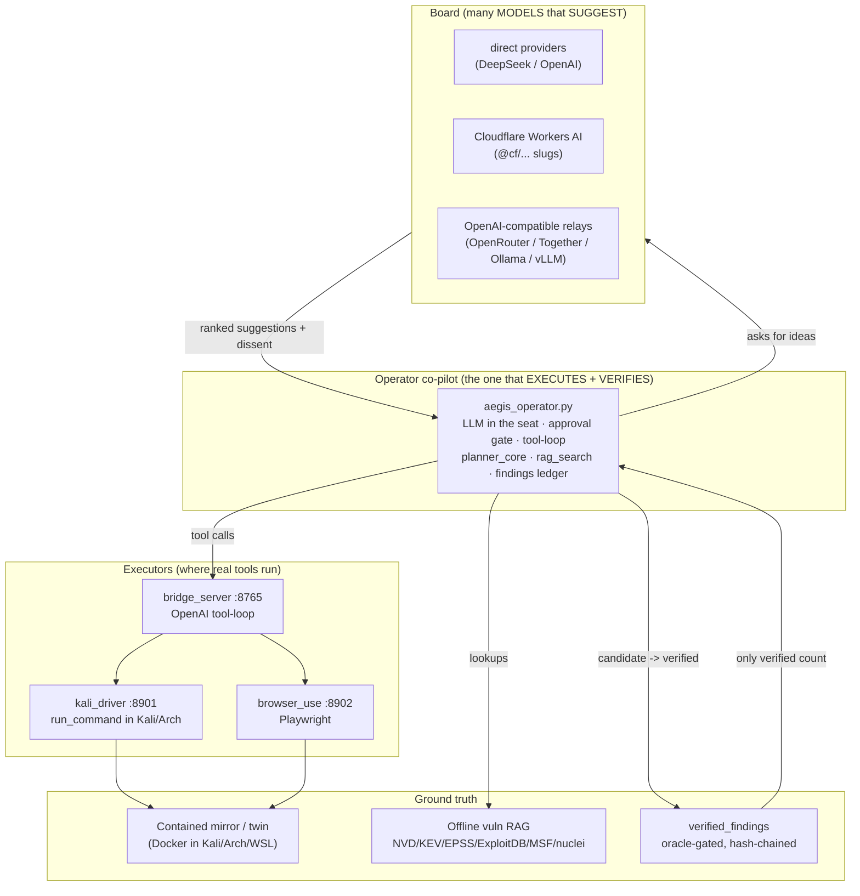

**Doctrine (defensive, non-negotiable):** authorized/owned targets only; contained-by-default;
non-destructive (plant/read a benign marker for proof, never erase/exfiltrate/DoS); stay in scope; only
oracle-verified findings count; circumvention/persistence/evasion are out of scope. See
`operator/aegis_operator.py::_DOCTRINE` and the per-mode guards.

### Processes / ports

| Process | Port | Role |
|---|---|---|
| `operator/aegis_operator.py` | — | The co-pilot: LLM seat, approval gate, tool-loop, `planner_core`, `rag_search`, findings ledger. Runs one-shot (`--task`) or interactive (`--chat`). |
| `orchestrator/bridge_server.py` | 8765 | OpenAI-compatible tool-calling loop that turns a task into tool calls, with the data-boundary / anti-hallucination system prompt. |
| `orchestrator/kali_driver_server.py` | 8901 | One MCP tool, `run_command`, executing shell in the Kali/Arch toolset (where the mirror + tools live). |
| `orchestrator/browser_use_server.py` | 8902 | Playwright browser automation as MCP tools. |

---

## 2. Three run modes — one engine, one set of vectors

All three modes share **one** budgeted discovery loop (`operator/iterative_hunt.py`) over the **same**
attack vectors (`operator/vectors.py`). They differ only in the *doctrine wrapper* each puts around a move.

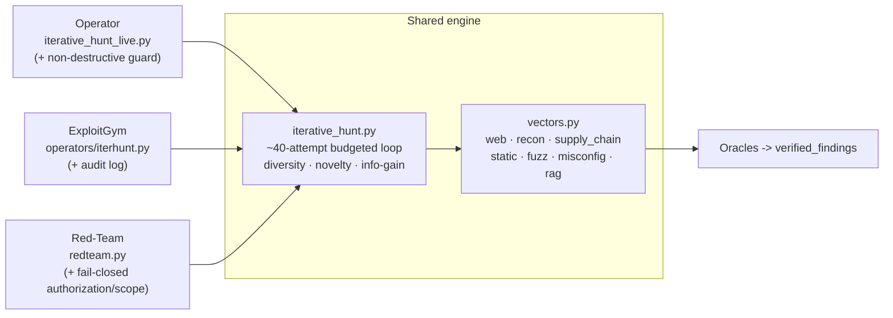

- **Operator** — the co-pilot's live hunt against the authorized mirror.
- **ExploitGym** — the contained autonomous-exploitation **benchmark** (scored, audited, reproducible).
- **Red-Team** — scope-enforcing first-class pentest with cross-host pivot chaining
  (`redteam/lateral.py`), guarded two ways by `redteam/authorization.py` (`classify_probe` →
  recon / active / destructive): safe read-only recon in-scope only; anything destructive or out-of-scope
  is blocked. Non-destructiveness alone is **not** authorization.

---

## 3. The discovery pipeline (stages 0–10)

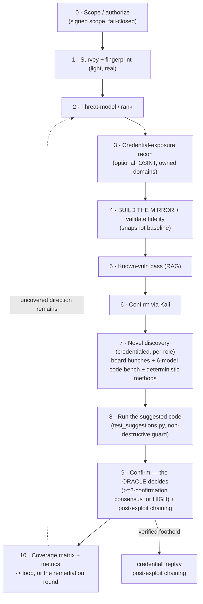

The board is consulted at **decision points 0, 2, 4, 5, 7, 10** (available everywhere). Board
data-hygiene: privileged context (creds/secrets) is sanitized before generalist models see it. The
verification gate at 6/8/9 is a **deterministic oracle** — mirror-not-prod, ground-truth scoring, never
self-report, every finding attributed to its source.

---

## 4. The Planner (pre-execution plan stage)

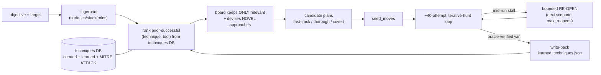

`operator/planner.py` ranks the techniques DB (`rag/techniques_db.json` + learned +
`rag/mitre_attack.json`), has the board keep only environment-relevant techniques and invent novel ones,
emits anchor `seed_moves`, scores multiple candidate plans, and re-opens the next scenario on a stall.
Verified wins are written back (closed loop). Kill-switch: `AEGIS_PLANNER=0`.

**CVE × technique fusion + agent extension (`cve_gaps` → `board_synthesize` → `board_extend`).** Beyond
ranking/novelty, the planner **combines the target's relevant CVE gaps with the technique toolset** into
*novel composed* approaches (a CVE chained with a technique, two CVEs via a precondition, a primitive reused
on an uncovered surface), then agents push each **further**. The **environment survey is a hard relevancy
filter** — `_fuse_moves` drops any proposal not grounded in a fingerprinted surface, so no random/off-target
tools or CVEs survive. Appropriate tool per stack, or `new-code` when none fits. Env gate: `AEGIS_SYNTH`.

---

## 5. The iterative-hunt loop (how the budget is spent)

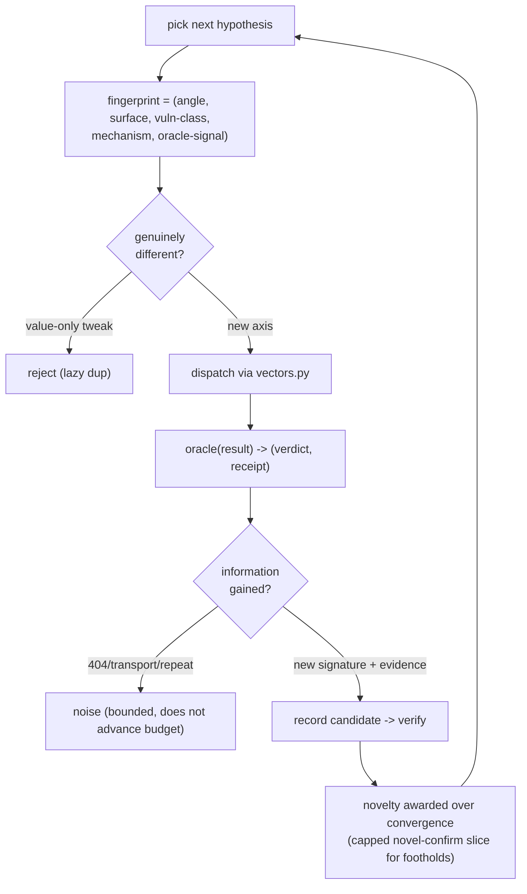

Breadth-first scheduling + a hard per-angle cap spread the budget; the payload *value* is excluded from the
fingerprint (a value-only tweak collides and is rejected); only **information-gaining** attempts count
against the budget; novelty is awarded over convergence.
Run: `python operator/iterative_hunt_live.py --objective "..." --role owner --budget 40`.

---

## 6. Attack vectors

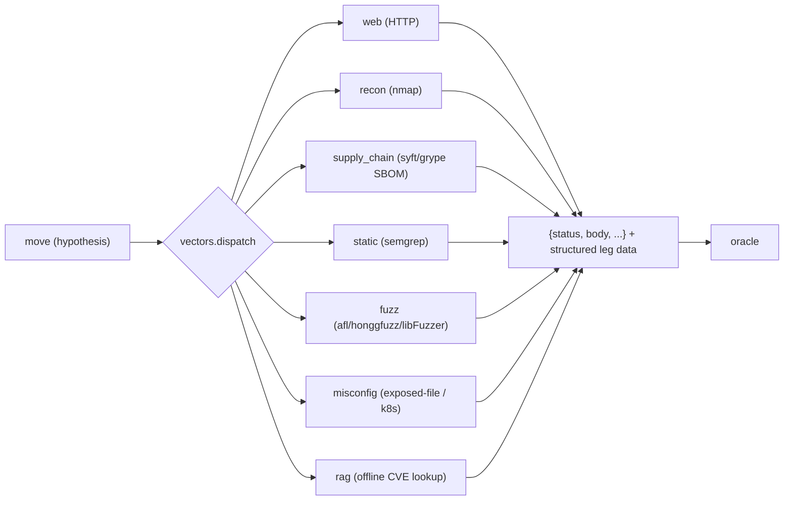

Every mode dispatches through the same vectors, so none is blind to a class the others see. Kali/Arch-backed
legs shell into the toolset; `web` uses `requests` (and is paced by the noise governor — §11).

---

## 7. The verification spine — oracles + verified findings

A finding is **not** a model's prose claim — it is an immutable, evidence-bearing object whose status moves
`candidate → verified | rejected` **only** via an out-of-band verifier running a ground-truth **oracle**.
Reports and benchmark scores count **only** `verified`.

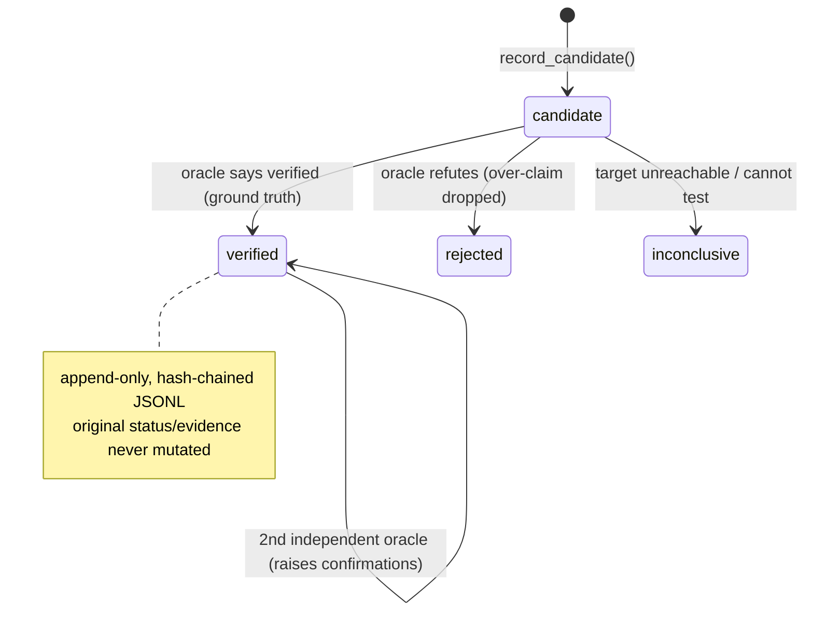

### 7.1 Storage: append-only, hash-chained, tamper-evident

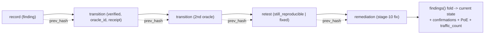

`shared/verified_findings.py` — `FindingStore` is an event-sourced, SHA-256 hash-chained JSONL log;
`verify_chain()` makes tampering detectable. A HIGH/critical needs **≥2 independent** oracle confirmations
unless a single **high-confidence ground-truth** oracle (canary/OOB callback, DB witness, SSRF-to-metadata,
DB-confirmed SQL/filter injection) confirms it alone.

### 7.2 Durable HTTP evidence, replay, and automated retest

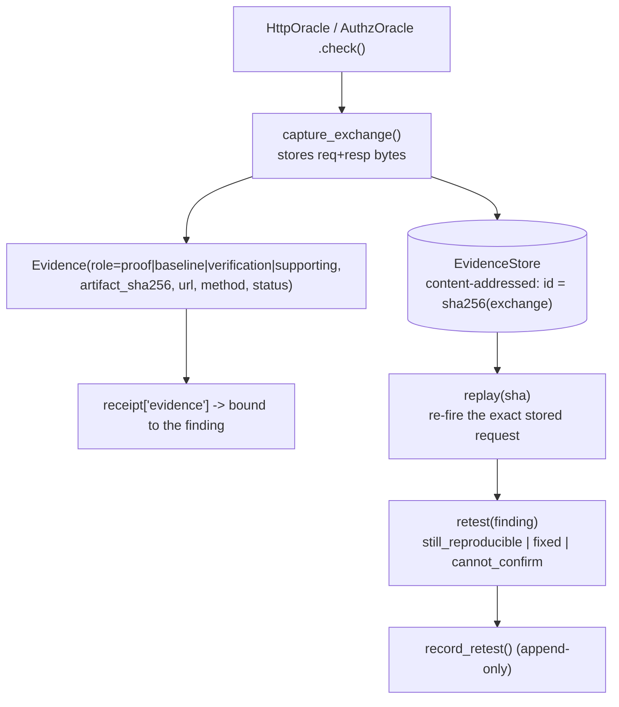

- **Evidence capture (role-tagged):** each live HTTP oracle persists the real request/response pair to a
  content-addressed `EvidenceStore` and binds it to the finding with a role. Kill-switch:
  `AEGIS_CAPTURE_EVIDENCE=0`; location: `AEGIS_EVIDENCE_DIR`.
- **Replay:** `replay(sha)` re-fires the exact stored request (optionally rebased to a new host) — proof is
  durable and auditable after the run.
- **Retest:** `operator/retest.py` (tool `retest_finding`, or CLI) replays a finding's bound proof against
  the current target and records `still_reproducible | fixed | cannot_confirm`, append-only — the stage-10
  closed loop for confirming a fix.

### 7.3 Proof-of-Exploitation (PoE) grade

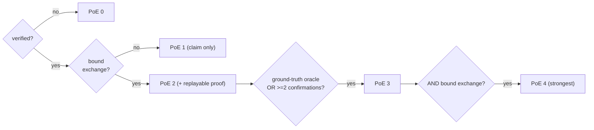

`grade_poe()` is shared by the chain fold and the report fold, so every surface grades a finding
identically. Reports show `PoE n/4, N ex` per finding.

### 7.4 The oracle family (33 attack angles)

Each oracle returns `(verdict, receipt)` and never raises into the loop. Coverage spans many surfaces:

- **Access control / authz:** `AuthzOracle` (cross-role broken-access, FP-resistant), `IdorOracle`,
  `IdorCrossUserOracle`, `MassAssignOracle`, `AuthStateOracle`, `PinPolicyOracle`.
- **Injection:** `SqlRawOracle`, `SqlAuthBypassOracle`, `FilterInjectionOracle`, `SstiOracle`,
  `XssOracle`, command-injection (via vectors) — DB-witness confirmed where possible.
- **Server-side / request forgery:** `SsrfOracle` (incl. cloud-metadata), `CsrfOracle`,
  `OpenRedirectOracle`, `CanaryCallbackOracle` (OOB), `FileUploadOracle`.
- **Session / auth strength:** `SessionFixationOracle`, `JwtForgeryOracle`, `BruteForceFeasibilityOracle`,
  `UserEnumerationOracle`, `TimingDifferentialOracle`, `RateLimitOracle`.
- **Business-logic / money invariants:** `InvariantOracle`, `IdempotencyOracle` (replay),
  `ResourcePersistenceOracle`, `NestedWriteOracle`, `DifferentialOracle`, `FieldLeakOracle`.
- **Exposure / hygiene:** `SecretsOracle`, `SecurityHeadersOracle`, `HttpOracle` (status+body with
  SPA/catch-all guard), `DbOracle` (ground-truth DB witness).

Plus 7 **vectors** (web · recon · supply_chain · static · fuzz · misconfig · rag), 8 **discovery legs**
(ldap · cloud · fingerprint · external · cred_harvest · sbom · honeypot · attackpath), and dedicated angle
modules (`jwt_forge`, `oob_beacon`, `signal_correlator`, `param_optimizer`, `xss_probe`, `injection`,
`schema_discovery`, `supply_chain_scan`, `symbolic_reach`, `crawler`, `frontdoor`, `reach`). The ExploitGym
benchmark exercises these across 9 deliberately-vulnerable targets and 11 scored scenarios.

### 7.5 Assurance: calibrated confidence + reflective self-verification

On top of oracle-verification, two trust layers make findings auditable (tracking the 2025–26 assurance
direction — MAPTA/JEV-style harnesses):

- **Calibrated confidence + false-positive rate (`grade_confidence`, `FindingStore.assurance`).** Every
  verified finding carries a **confidence 0..1** from proof depth (PoE), independent confirmations,
  ground-truth-oracle presence and bound replayable evidence — **downgraded by oracle DISAGREEMENT** (a
  finding with both a `verified` and a non-`verified` verdict) and by a high reflective FP-risk. `assurance()`
  reports the **false-positive rate** (`rejected / (verified+rejected)`), inconclusive rate, disagreement
  count, mean confidence and the low-confidence list — the trust numbers, not just capability.
- **Reflective self-verification (`operator/reflect.py`, advisory).** A cheap board pass *adversarially
  argues each verified finding could be a false positive* (SPA/catch-all 200, intended behavior, state
  artifact, deceptive target, oracle proved the wrong thing), judging only from the finding + receipt + bound
  evidence. It records `{fp_risk, reasons, recommend}` append-only, **lowers confidence, and flags high-risk
  findings for review — but never changes status** (the oracle stays ground truth). Env gate: `AEGIS_REFLECT`.
- **Deceptive-target robustness (`operator/deception.py`, ATOBench-style).** A deceptive / honeypot target
  emits a "success" signal (200, reflected payload, canned vuln banner, slow response) for *every* input, so a
  weak oracle that only reads that signal is fooled. Before a **deceivable** oracle (status/body/timing/rate —
  anything not in `_HIGH_CONF_ORACLE`) counts a positive, the loop runs a **negative control**: the same
  request shape with a benign/nonsense payload that must *not* trigger the vuln. `deception_verdict` classifies
  the pair — `clean` (positive fired, control silent → a real differential signal), `deceptive` (benign control
  also fired → target says success to anything), `untested` (deceivable oracle fired with no control). A
  `deceptive`/`untested` verdict on a weak oracle forces `disagreement` in the fold so confidence collapses.
  **Ground-truth oracles are exempt** — a canary echo / OOB callback / DB witness needs a specific side-channel
  witness an always-success target cannot fabricate, so a honeypot cannot deceive them (proven in
  `shared/_deception_tests.py`). In the live loop the novel-code HTTP leg derives the verdict from its existing
  nonexistent-path baseline differential and carries it into the finding's oracle receipt.

---

## 8. The multi-model board + 6-model code bench

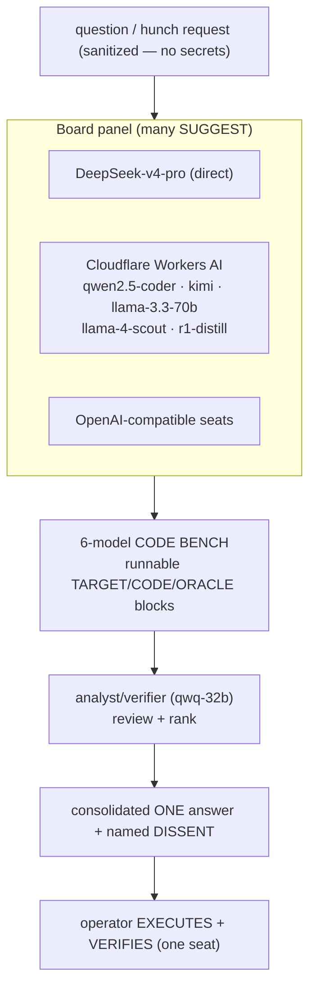

**Doctrine: many suggest, one executes + verifies.** The board brainstorms and writes candidate exploit
code; the operator is the single seat that runs it and lets the oracle decide. Board models **do not**
self-enforce doctrine — code-level guards are the real control; model output is never auto-applied to
protected files.

- `operator/code_suggester.py all "<prompt>"` — fan out the code bench; `--review` ranks via qwq-32b.
- `operator/code_review.py` — periodic board review of this repo (redacts secrets; advisory).
- `operator/board_ask.py "<question>"` — ask the panel; watch live with `board/live_board.ps1`.

**Claude is a permanent code-generation / probing seat — via the Claude CLI, not an API key.** The
`claude` seat in `CODE_SUGGESTERS` (and `board_roster.json`) is backed by `claude -p` headless
(`operator/code_suggester.py::_claude_cli`): it emits the same `TARGET/CODE/ORACLE` blocks the operator
runs oracle-verified against the authorized, contained mirror. It skips gracefully when the CLI is absent;
override the binary with `AEGIS_CLAUDE_CLI` and the timeout with `AEGIS_CLAUDE_CLI_TIMEOUT`. No Anthropic
API key is required — install the Claude Code CLI and ensure `claude` is on `PATH`.

Connecting providers (Cloudflare / direct / OpenAI-compatible) and the chat: see **§14**.

---

## 9. Confirmation gates (where truth is enforced)

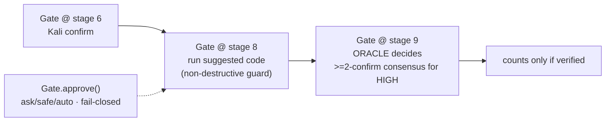

Two independent layers: **evidence gates** (6/8/9 — deterministic oracles decide truth) and the
**runtime approval gate** (`Gate` in `aegis_operator.py` — human-in-the-loop for mutating/outward actions,
fail-closed on EOF/interrupt, audit-logged with secret redaction; read-only tools may auto-run in
non-`ask` modes).

---

## 10. Gap / exploit driving (coverage → next move)

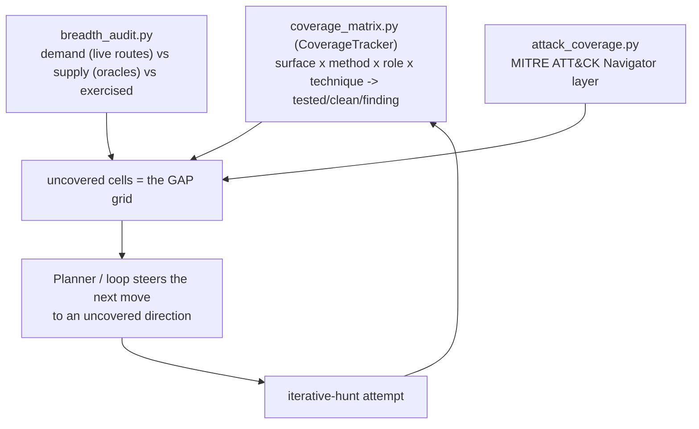

Coverage is the denominator: the loop and Planner push attempts toward **uncovered** surfaces/techniques,
and a stall triggers a bounded re-open to the next candidate scenario rather than thrashing one idea.

---

## 11. Runtime safety controls

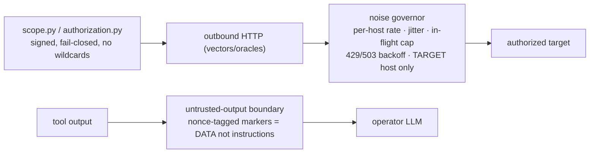

- **Noise governor** (`operator/noise.py`): `AEGIS_NOISE_PROFILE=quiet|balanced|aggressive`; paces only the
  `AEGIS_TARGET` host(s) — never the LLM/board APIs; default-off.
- **Untrusted-output boundary** (`_frame_tool_output`): tool results are framed in per-call nonce markers so
  the model treats them as data, not instructions. Kill-switch: `AEGIS_UNTRUSTED_BOUNDARY=0`.
- **Scope/authorization** (`operator/scope.py`, `redteam/authorization.py`): signed, contained-by-default,
  wildcards refused, fail-closed; the cloud metadata-SSRF address is deliberately excluded from "contained".

---

## 12. The fuzzer (grey-box, coverage-guided)

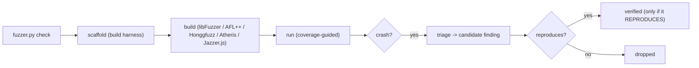

Grey-box fuzzing of the mirror's **own buildable source** via self-hosted OSS-Fuzz tooling, contained in
Kali/Arch/Docker. Languages: C/C++, Python (Atheris), Go/Rust/JVM, and JS/TS via Jazzer.js. Crashes are
candidate findings, verified only when they reproduce. Non-destructive.

---

## 13. Remediation (stage 10, end of pipeline)

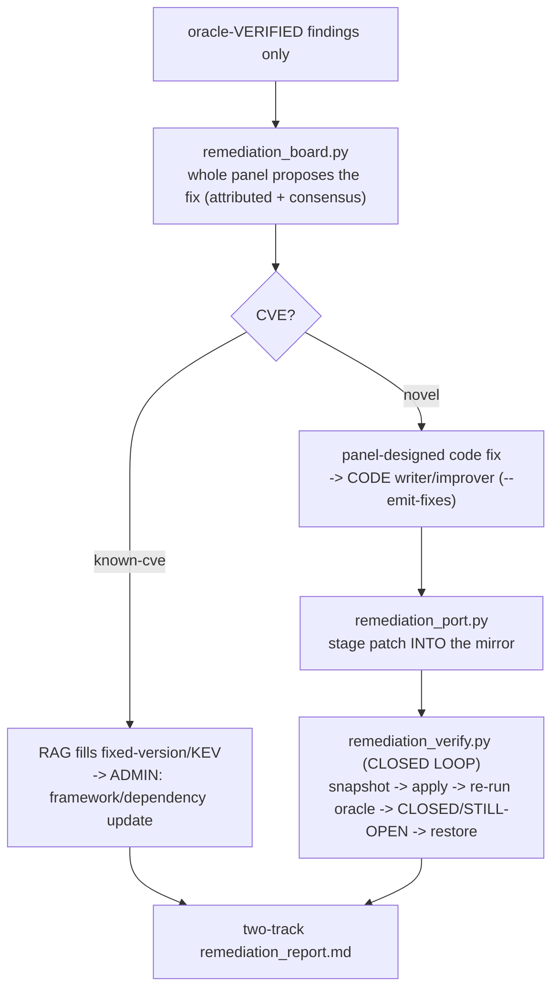

Mirror-side only: fixes target the twin where findings were confirmed; **proposed, never auto-applied,
never run against a real target**. The operator can run the round autonomously
(`aegis_operator.py --remediate-on-finish`).

---

## 14. Connecting board AI providers + the chat

The board is model-agnostic. There are **three routes** to add a seat; mix freely.

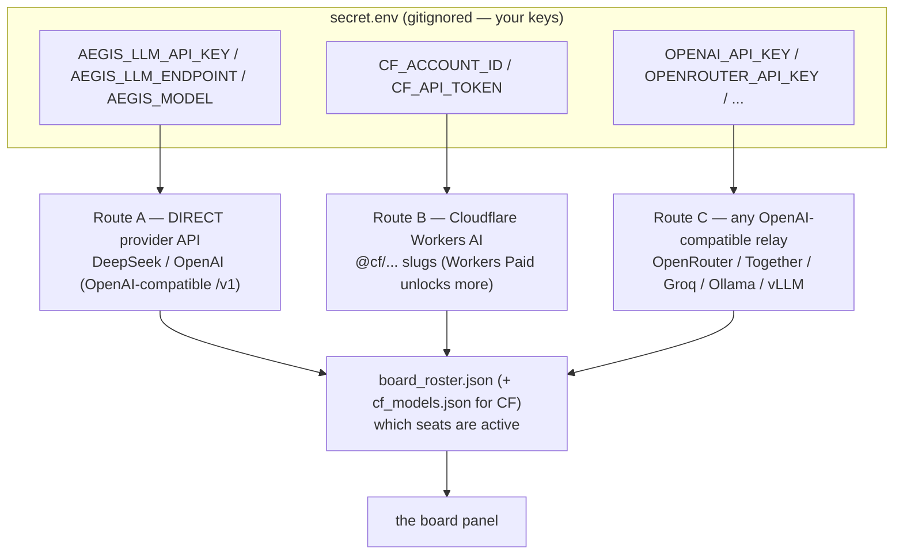

### Route A — a direct provider key (DeepSeek / OpenAI, OpenAI-compatible)
1. `cp secret.env.example secret.env` (gitignored — never commit it).
2. Set the operator brain + endpoint:
   ```ini
   AEGIS_LLM_API_KEY=sk-...                          # your provider key
   AEGIS_LLM_ENDPOINT=https://api.deepseek.com/v1    # any OpenAI-compatible /v1 base
   AEGIS_MODEL=deepseek-v4-pro                        # model id the endpoint exposes
   # OPENAI_API_KEY=sk-...                            # if using OpenAI directly
   ```
3. The operator and board read these at start. Model defaults live in `operator/config.py`.

### Route B — Cloudflare Workers AI (the CF coders)
1. In `secret.env`:
   ```ini
   CF_ACCOUNT_ID=<your-account-id>
   CF_API_TOKEN=<token with Workers AI:Read/Run>
   ```
2. CF seats are defined in `cf_models.json` (slug → `@cf/...`) and wired by `operator/cf_agent.py`;
   `board_roster.json` lists the active seats + the `code_suggester` seats. Free tier reaches a couple of
   models; Workers **Paid** unlocks the full coder set. Any unavailable/403 model is skipped gracefully.
3. Add a seat: slug → `cf_models.json`, name → `board_roster.json`, (optional role prompt in
   `cf_agent.ROLE_PROMPTS`); it joins the next board call.

### Route C — any OpenAI-compatible aggregator / local runtime
OpenRouter, Together, Groq, Ollama, vLLM — anything speaking the OpenAI Chat Completions API:
1. Add the key to `secret.env` (e.g. `OPENROUTER_API_KEY=...`); local runtimes are keyless.
2. Point a seat's base URL at the relay and set the model id (per `operator/config.py` /
   `board_roster.json`). Local example: `http://127.0.0.1:11434/v1` (Ollama).

> **Provider notes:** reasoning models (kimi, r1-distill) and DeepSeek "think" by default — for answer-only
> paths disable thinking or give a large token budget, else `content` comes back empty. CF may return
> `message.content` as a dict/list — normalize to text (see `code_review.py::_as_text`). Board chat can use
> a cheaper/faster model while the executor brain stays on the benchmarked model.

### The chat / standby (interactive co-pilot)
The operator runs as an interactive **standby** co-pilot: DeepSeek (or any configured brain) sits in the
seat with all tools loaded and context kept across turns; you drive it at a prompt exactly like a task, and
name the target when ready. Approval mode is `ask | safe | auto`.

```bash
# one-liner standby launcher (Windows PowerShell) — brings the co-pilot up in --chat
./ds-standby.ps1                          # standby, no target, safe mode (auto read-only, prompt on the rest)
./ds-standby.ps1 -Target https://localhost:8443 -TargetMode mirror
./ds-standby.ps1 -Mode ask                # prompt on every action   (-AutoApprove = -Mode auto)
./ds-standby.ps1 -Session ./ds.json -Resume   # save/continue a session (/resume works live too)

# or directly, any OS
python operator/aegis_operator.py --chat --provider deepseek
python operator/aegis_operator.py --task "assess the authorized mirror at $AEGIS_TARGET" --target-mode mirror --max-iter 40
```

**Switch the driving agent on the fly** — mid-chat, change the brain without losing context. From
`_BRAIN_CMDS` (single source of truth, so the banner never drifts):

| Command | Brain | `-think` variant |
|---|---|---|
| `/ds` (`/deepseek`) | DeepSeek | `/ds-think` |
| `/kimi` (`/k2`) · `/kimi-code` | Kimi (Cloudflare) | `/kimi-think` |
| `/qwen` (`/qw`) | Qwen2.5-Coder (Cloudflare) | `/qwen-think` |
| `/scout` (`/llama4`) · `/llama` (`/l`) | Llama-4-Scout / Llama-3.3 | `/scout-think` |
| `/cerebras` (`/cb`) · `/openrouter` (`/or`) | Cerebras / any OpenRouter model | — |
| `/claude` | Claude seat (if configured) | — |
| `/next` | cycle to the next brain | — |
| `/think` `/reason` · `/nothink` `/fast` | toggle reasoning for the **current** brain | — |

Other in-chat commands: `/session` save/`/resume`, `/compact` (fold history), `/stop` (end the task
cleanly). `--chat` and `--task` share the **same** tool-loop, so every tool (`retest_finding`,
`remediation`, …) and the untrusted-output boundary apply identically in standby.

### The board chat (ask the panel, watch it live)
The multi-model **board** is a file-based blackboard the human can query through the operator:
```bash
python operator/board_ask.py "which surface should we prioritise next: the auth flow or the payment path?"
python operator/board_ask.py "..." --panel ds,coders      # limit who answers (ds + the coder bench)
board/live_board.ps1                                       # watch the board update live (~25s refresh)
```
The panel answers on the board (consolidated, with named dissent); the operator — the single executing
seat — decides and verifies. `operator/cf_agent.py` adds Cloudflare seats; `operator/board_discuss.py` /
`board_feedback.py` drive multi-round board discussion.

---

## 15. Map of the code

| Area | Path | What |
|---|---|---|
| Operator co-pilot | `operator/aegis_operator.py` | LLM seat, gate, tool-loop, ledger |
| Planner | `operator/planner.py` | pre-execution plan + candidate scenarios |
| Task-graph executor | `operator/planner_core.py` | bounded multi-step execution |
| Hunt loop | `operator/iterative_hunt.py` (+ `_live.py`) | budgeted adaptive discovery |
| Vectors | `operator/vectors.py` | web/recon/supply_chain/static/fuzz/misconfig/rag |
| Verification spine | `shared/verified_findings.py` | oracles, hash-chain, EvidenceStore, replay, PoE |
| Retest | `operator/retest.py` | replay-based still_reproducible/fixed |
| Noise governor | `operator/noise.py` | request pacing + 429/503 backoff |
| Coverage | `operator/coverage*.py`, `shared/coverage_matrix.py` | gap grid |
| Board | `operator/code_suggester.py`, `code_review.py`, `cf_agent.py`, `board_ask.py` | multi-model panel + code bench |
| Fuzzer | `operator/fuzzer.py`, `fuzz_driver.py`, `fuzz_targets.py`, `seed_gen.py` | grey-box coverage fuzzing |
| Remediation | `operator/remediation_board.py`, `remediation_port.py`, `remediation_verify.py` | stage-10 closed loop |
| Red-Team | `redteam/` | scope-enforcing pentest + lateral/pivot |
| Benchmark | `exploitgym/` | contained autonomous-exploitation benchmark + targets |
| Executors | `orchestrator/` | bridge (8765) + kali_driver (8901) + browser_use (8902) |
| RAG | `rag/` | offline vuln store + ingest/query + techniques DB |

See also: `INSTALL.md`, `docs/PIPELINE.md`, `docs/PLANNER.md`, `docs/SCORING.md`, `docs/BOARD.md`,
`docs/EXPLOITGYM_PROGRESSION_SPEC.md`, and `README.md`.
